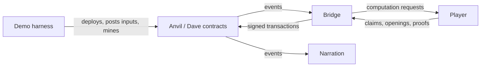

# Lua PRT bridge

The README's [permissionless refereed
tournament](../README.md#permissionless-refereed-tournament) runs the players of
[prt.lua](prt.lua) against a Lua model of the Dave contracts. This recipe runs
the same players against the real contracts, on a local Anvil chain. It deploys
a Dave application, streams the README's two calculator epochs into it, and lets
one honest player and seven scripted adversaries dispute each epoch until the
honest result is accepted and the bonds are recovered. Epoch zero stays empty,
as in a normal Dave deployment.

Two things change relative to the model. Time is chain time, so a player that
computes too long misses its window. And every response is a signed transaction,
so a player must track what it published, survive reorgs, and restart without
losing its claims. The bridge is the code that does this. It turns contract
events into calls on the player and the player's answers into transactions.

## Running the recipe

Run these from the emulator repository.

```sh
make -C doc build-prt-image
make -C doc run-prt-bridge PRT_MODE=smoke
make -C doc run-prt-bridge
```

`build-prt-image` builds the runtime image `cartesi/machine-emulator-prt:devel`,
which holds the emulator, the calculator snapshot, the compiled Dave contracts,
Foundry, and the Lua scripts. With `EMULATOR_IMAGE_READY=yes`, it reuses an
emulator image that is already built. `run-prt-bridge` runs everything inside
the container. Smoke mode uses one honest player. The default story uses eight
players per calculator epoch.

For development, `make -C doc test-prt-bridge` runs the current sources on the
host. The container runs only Anvil, published on `127.0.0.1` at `PRT_RPC_PORT`
(default `8545`). Deployment, the harness, and every player run on the host,
whose filesystem has the reflinks stored machines rely on. The target copies the
Dave contract artifacts out of the image once per image, and needs Foundry's
`cast` and the `dkjson` rock on the host.

| Target | Runs |
| --- | --- |
| `test-prt-bridge` | The story, on the host |
| `test-prt-bridge-unit` | The bridge fixtures |
| `test-prt-transactions` | The transaction tests on Anvil (`PRT_MODE=transactions` in the container) |
| `test-prt-proofs` | The proof tests on a chain of their own (`PRT_MODE=proofs` in the container) |
| `test-prt-protocol` | The README's protocol suite |

The run targets accept these variables.

| Variable | Default | Effect |
| --- | --- | --- |
| `PRT_INPUT_CONFIRMATIONS` | `8` | Observation policy for inputs and seals |
| `PRT_DISPUTE_CONFIRMATIONS` | `4` | Observation policy for dispute events |
| `PRT_FEE_BUMP_BLOCKS` | `3` | Blocks a transaction may stay pending before it is replaced |
| `PRT_FEE_BUMP_PERCENT` | `15` | Minimum fee increase of a replacement |
| `PRT_MAX_FEE_PER_GAS` | 100 gwei | Fee ceiling |
| `PRT_MAX_PRIORITY_FEE_PER_GAS` | 10 gwei | Tip ceiling |
| `PRT_TEST_REORG` | `no` | Reorganize epoch one's dispute (see [The demo harness](#the-demo-harness)) |
| `PRT_TEST_RESTART` | `no` | Kill the honest player during epoch one (see [The demo harness](#the-demo-harness)) |
| `PRT_PROFILE` | `no` | Time each player's RPC calls, decoding, handlers, and passes, reported in its status |

These values are demo settings, not a guarantee of timely inclusion or of safety
against reorgs.

Each run creates a directory under `doc/recipes/cache/prt-chain/` (or under the
absolute host path in `PRT_OUTPUT_DIR`).

| Path | Contents |
| --- | --- |
| `story.txt` | The narration of the three epochs |
| `deployment.json` | The deployed addresses |
| `anvil.log` | The chain's own log |
| `reorg.json` | With `PRT_TEST_REORG=yes`, the replaced tip, the observation height, and the depth |
| `checkpoints/epoch-N/` | The machine every player starts epoch N from |
| `players/<label>/` | The player's state, its `log.txt`, and the `pid` its supervisor last started |
| `players/<label>/journal.json` | The transactions the player signed that a reorg could still reopen |
| `players/honest/epoch-N/` | The honest player's stored epoch |

## Design

The goal is a validator that is simple to write. Dave's contracts define and
enforce the dispute rules. Their events should tell a validator what to do next
without making it rebuild the dispute's state or reproduce the contracts' logic.

Each event therefore reads as a remote procedure call into the validator. It
means "once the chain reaches this block, call this contract method with this
context and the data you compute off chain." The event names the claims, the
tree node to open, and the window in which to answer. The validator computes the
missing claim data or proof, and nothing else. For example, a `MatchAdvanced`
event lets the player answer the next bisection without replaying the match's
earlier moves.

The validator keeps its own claims, the computations behind them, and the
transactions it signed. Everything else is derived again from the logs on every
observation. Each observation starts from an empty set of candidate calls and
applies the events in order. Later events replace or cancel the calls earlier
ones authorized. Restarting, or switching to another branch after a reorg, needs
no recovery procedure for the dispute, since the next observation derives
everything again.



The contracts own pairing, clocks, move validity, and results. The player owns
machine execution, computation hash trees, and proofs. The bridge turns events
into player requests and transactions. The harness owns deployment, the choice
of players, mining, and narration, and exists only in the demo.

| File | Responsibility |
| --- | --- |
| [Dockerfile.prt](../Dockerfile.prt) | Fetch, patch, and compile the contracts, and package the emulator and recipe |
| [prt-demo.sh](prt-demo.sh) | Prepare the run directory and keystores, and start and stop Anvil |
| [prt-deploy.lua](prt-deploy.lua) | Deploy Dave's contracts and the application, for the demo and the proof tests |
| [prt-demo.lua](prt-demo.lua) | The harness. Launch the players, post inputs, mine, and narrate |
| [prt-player.lua](prt-player.lua) | One player process. Discover the deployment from the application and follow its epochs |
| [prt-supervise.sh](prt-supervise.sh) | Relaunch a player whenever it exits |
| [prt-epoch.lua](prt-epoch.lua) | The epoch listener. Deliver the inputs and the seal, then start the dispute bridge |
| [prt-bridge.lua](prt-bridge.lua) | The dispute bridge. Observe the dispute, derive calls, ask the player, and submit |
| [prt-log-history.lua](prt-log-history.lua) | Fetch logs incrementally, in pages, and drop the ones a reorg replaced |
| [prt-transactions.lua](prt-transactions.lua) | Journal signed transactions, reconcile nonces, and replace pending ones within fee limits |
| [prt-ethereum.lua](prt-ethereum.lua) | Decode events, encode calls, translate coordinates, and serialize proofs |
| [prt-cast.lua](prt-cast.lua) | JSON-RPC over a persistent HTTP connection, and `cast` for signing |
| [prt-websocket.lua](prt-websocket.lua) | Subscribe to new block headers over WebSocket |
| [prt.lua](prt.lua) | The player. Execute inputs, build claims and proofs, and store epochs and checkpoints |
| [prt-dishonest.lua](prt-dishonest.lua) | The scripted adversaries, built on the same player |
| [prt-bridge-test.lua](prt-bridge-test.lua) | Encoding, scheduling, log history, and process-boundary fixtures |
| [prt-transactions-test.lua](prt-transactions-test.lua) | Gas surges, dropped transactions, cancellation, journal reload, and nonce reorgs |
| [prt-proof-test.lua](prt-proof-test.lua) | Native and Solidity transition verification over the calculator inputs |

### One process per player

Each player runs as its own process, `prt-player.lua`, under `prt-supervise.sh`,
which relaunches it when it exits. Each run of the process leads its own process
group, and the supervisor ends the group with the process, so no machine server
outlives it. From the application's address alone, the process discovers the
consensus, the input box, the tournament factory and its geometry, the
deployment block, and the claim staging period. It checks the template hash and
the verifier's pristine uarch hash before playing. Its other settings are
arguments, listed at the top of `prt-player.lua`. With a WebSocket endpoint, it
waits for the node to push each new block header, and still reads the tip once
per poll interval in case it missed one. Otherwise it reads the tip once per
poll interval. A player refuses to start if its account already has pending
transactions its journal does not know, since it must own every nonce of its
account.

The process follows every epoch from its first one. For each epoch, an epoch
listener delivers the inputs and the seal to a player, and then a dispute bridge
answers the epoch's tournament. The bridge calls the player's handlers directly,
the same handlers the README's referee calls over a socket.

The honest player stores each epoch in `players/honest/epoch-N/`, which holds
the epoch machine and its snapshot, the machine cache, the claim forests, and
the epoch's inputs and outputs. Its stored machines are clones that share every
unchanged block, so an epoch costs only the pages its inputs changed. They run
in the player's own process, so their locks end with it, and a relaunched
process reopens them. The scripted adversaries keep their epochs in memory and
compute them again after a relaunch.

## Image and deployment

The Dockerfile fetches the Dave revision pinned by `DAVE_REF` in
`doc/Dockerfile.prt` (the v3.0.0-alpha.6 release, which includes [Dave pull
request 297](https://github.com/cartesi/dave/pull/297) and the events the bridge
consumes). [prt-contracts.patch](prt-contracts.patch) replaces only Dave's
two-level tournament table with the recipe's geometry. It keeps Dave's events,
gas allocations, and commitment budget. The build checks and applies the patch
and compiles through Dave's `just build-smart-contracts`, so a run deploys
packaged artifacts and compiles nothing.

The recipe's root tournament has height 62 and stride 2<sup>30</sup>, and its
leaf tournaments have height 30 and stride 1. This is the players'
`prt.new_geometry(10)` (2<sup>10</sup>-mcycle periods). Dave's own table (root
height 54 at stride 2<sup>38</sup>, so 2<sup>18</sup>-mcycle periods) would make
each uarch claim about 256 times more expensive to build. Every player reads the
table from the factory and refuses one that is not a two-level PRT geometry.

The release's `machine/step` is generated against the emulator release this
build uses, so their pristine uarch states match. A matching `CM_MARCHID` does
not guarantee that, which is why each player compares the deployed verifier's
pristine hash with the emulator's before playing.

`prt-deploy.lua` deploys, in order, the `Tournament` implementation and the
`CartesiStateTransition` verifier, `CanonicalTournamentParametersProvider` and
`MultiLevelTournamentFactory`, the Rollups `InputBox` and `ApplicationFactory`,
and Dave's `DaveAppFactory`. It then calls `newDaveApp`, which creates the
application and its `DaveConsensus` in one transaction. The calculator
configures no withdrawals, refund portals, or sentries, and its staging period
is ten blocks. The deployer and the input sender use account zero, and each
player uses the same one of accounts one through eight in every epoch.

## Epochs

| Dave epoch | Global input indices | Calculator payloads | New global output indices |
| --- | --- | --- | --- |
| 0 | none | empty bootstrap | none |
| 1 | 0-2 | `6*2^1024 + 3*2^512`, `invalid input`, `2^2048` | 0-1 |
| 2 | 3-5 | `(2^256 - 1) * (2^256 - 1)`, `scale=80; sqrt(2)`, `scale=100; 355/113` | 2-4 |

These are the README calculator's two input groups, numbered one and two to keep
Dave's empty epoch zero. Each payload ends with a newline. The calculator
rejects the invalid input, which adds no output.

`DaveConsensus` seals epoch zero at deployment. Its inputs for the next epoch
arrive while it awaits settlement, so each epoch's inputs are executed before
its seal arrives, and the seal only finalizes the claim.

| Step | Computation and storage | Chain |
| --- | --- | --- |
| Deploy | Store the template as `checkpoints/epoch-0/`. The bootstrap player seals epoch 0 from it and stores `checkpoints/epoch-1/` | The application and consensus are created, and epoch 0 is sealed |
| Accumulate epoch 1 | Load `checkpoints/epoch-1/` and process inputs 0-2 as they are confirmed | Inputs enter the `InputBox` while epoch 0 is unsettled |
| Settle epoch 0 | On the next seal, finalize epoch 1 and store `checkpoints/epoch-2/` | Epoch 0 is staged and accepted, which seals epoch 1 |
| Accumulate epoch 2 | Load `checkpoints/epoch-2/` and process inputs 3-5 as they are confirmed | Inputs enter the `InputBox` while epoch 1 is unsettled |
| Settle epoch 1 | On the next seal, finalize epoch 2 and store `checkpoints/epoch-3/` | Epoch 1's disputes resolve, and its result is staged and accepted, which seals epoch 2 |
| Settle epoch 2 | Check its accepted result against `checkpoints/epoch-3/` | Epoch 2's disputes resolve, and its result is accepted, which seals empty epoch 3 |

The epoch listener reads the `InputBox` and consensus logs through the block its
input policy selects. For each `InputAdded` of the application, it requires
consecutive global indices and calls the player's `input_added(index -
input_begin, filename)` with the exact input bytes in a temporary file that
lasts only for the call. A stored player copies the file into its epoch
directory, and a player in memory keeps the bytes. The bytes include the
`InputBox` metadata, and proofs always use them, even when a dishonest player
substitutes a forged input.

On `EpochSealed`, the listener checks the initial machine hash, the preceding
outputs root, and both input bounds against what it processed. It seals the
player with `epoch_sealed(input_count, checkpoint_directory)`, where only the
honest player receives a directory to store the next epoch's checkpoint in, and
then starts the dispute bridge. A relaunched process delivers every input and
the seal again from the chain, and a stored player ignores the ones it already
applied. A changed input history aborts. Once sealed, the listener only checks
that the seal's block is still canonical. A reorg that crosses the seal requires
rebuilding the epoch, while ordinary dispute reorgs leave the player intact.

### Checkpoints

A checkpoint is the machine the next epoch starts from. Each
`checkpoints/epoch-N/` holds the stored machine, `outputs-frontier.json` (the
outputs frontier in the format of the `cartesi-machine` `outputs_frontier`
option), and `epoch.json` (the format version, the initial and final machine
hashes, the outputs root and count, the input count, and the period geometry).
The outputs frontier lets the next epoch continue the output history. An epoch
without outputs leaves it unchanged, and the template's checkpoint holds an
empty one.

A checkpoint is written under `<directory>.tmp` and renamed into place, so it is
either complete or absent. The honest player stores it at the seal, before it
commits the seal to its epoch directory, so a seal delivered again after a crash
stores it again. Starting a player from a checkpoint looks like this.

```lua
local prt = require("prt")
local dapp, previous_outputs_frontier = prt.load_epoch(checkpoint_directory)
local player <close> = prt.new_player(dapp, "honest", previous_outputs_frontier)
```

`prt.load_epoch` validates the manifest and the outputs frontier. The player
checks the machine hash and binds the frontier's root to the machine's CMIO TX
buffer. The demo checks that every accepted epoch matches the next checkpoint,
and the proof tests seal an empty continuation of a calculator checkpoint and
check that its machine and outputs root are unchanged.

## Observing the dispute

### Observation policies

Inputs and dispute events are observed at separate depths. A policy is a number
of blocks behind the tip (depth k selects block max(0, tip - k)), or the RPC tag
`safe` or `finalized`. A missing tag fails instead of falling back to the tip.
Standalone players default to `finalized` for inputs and four blocks for
disputes. The demo uses eight and four blocks, so delayed observation is
exercised. Anvil's tags do not reproduce Ethereum's consensus, which is why the
demo uses depths.

The observed block authorizes calls, but the tip decides whether a call is still
in time, since a transaction is included after the tip. Confirmation delay,
computation, RPC latency, and inclusion delay must together fit the windows the
events give.

### Logs

The bridge fetches the logs of the factory, the consensus, the root tournament,
and every child tournament a `NewInnerTournament` event announces, through the
observed block. `prt-log-history.lua` fetches incrementally. An address's first
request starts at the consensus deployment block (a child's at the block that
created it), and later observations fetch only the blocks after the last one
fetched. After a reorg it drops the logs past the newest block it knows is still
canonical and fetches again from there. Providers limit the block range or log
count of a request in different ways, so the range is fetched in pages. The
first page is the whole range. A failed request halves the page and a successful
one doubles it. A failure on a single block is raised.

Event layouts come from the compiled ABIs, and `cartesi.evmu` decodes them with
full 256-bit coordinates. The bridge sorts the logs by block and log index and
rejects duplicate positions. A removed log, two hashes for one block, or an
observed block that is no longer canonical discards the observation, and the
next one fetches everything again. The bridge also checks that the epoch seal
binds the configured root tournament to the expected initial machine hash.

All reads go over one persistent HTTP connection, replaced when the node has
closed it. A request is never sent twice, since after a failure only observing
the chain can tell whether the node acted on it.

### From events to calls

Each observation derives the candidate calls, which we call jobs, from the
events. A job holds the contract and method, the arguments the events supply,
the first block at which the call is valid, an optional expiry (the first block
at which it is not), and the computation still needed from the player.

Some jobs act on one match. They answer a request to open a node or prove a
transition, claim a timeout win, or eliminate the match. A `MatchAdvanced` event
replaces the match's jobs, and `MatchDeleted` cancels them. Other jobs act on a
tournament's result. They propagate a child's winner to its parent, eliminate a
finished child, stage a root result, or recover a bond. A `StandingChanged`
event replaces the tournament's result jobs, but each remains a separate call,
so propagating a winner leaves its bond recovery pending. Match jobs are keyed
by tournament, match, and kind (respond, timeout win, or eliminate). Result jobs
are keyed by tournament and kind (propagate, eliminate, stage, or recover).

The table follows the tournament ABI of the pinned Dave revision. H is the
emitted descriptor height. own(x) means the player holds commitment x in that
context. claimer(x) means the player holds x and the bridge's own join
established it, as the submitter of `CommitmentJoined` shows. A tournament's
joining deadline is descriptor.startInstant + descriptor.allowance. Everyone
means every bridge created with cleanup, which in the demo is only the honest
player's. A claim's root children come from
`player.trees[computation_hash]:get_child_hashes(0, tree.height)`, and parent
propagation uses the parent claim's tree.

| Event | Action-set changes | Player computation | Window |
|---|---|---|---|
| TournamentCreated(R, descriptor, bondValue) | Populate R's context with the emitted descriptor and bond, pending association with EpochSealed | None | Immediate |
| InputAdded(app, index, input) | Verify and materialize the input for this application | input_added(index - lo, filename) on the open epoch player | As inputs arrive, before sealing |
| EpochSealed(e, lo, hi, initialHash, R) | Record the root tournament and epoch association, watch R, install join with the descriptor and bond from TournamentCreated | Check initialHash and the processed input bounds, epoch_sealed(hi - lo), then commit_mcycle_claim | Before R's joining deadline |
| MatchCreated(h, one, two, leftOfTwo, responderDeadline, eliminableAt) | Holder of one responds. Holder of two may win by timeout. Everyone installs elimination | Respond with reveal_bisection(one, 0, H, leftOfTwo), or seal_divergence(one, 0, leftOfTwo) for H = 1. Timeout uses the root children of two. Elimination needs no computation | Respond before responderDeadline. Timeout in [responderDeadline, eliminableAt). Eliminate from eliminableAt |
| MatchAdvanced(h, one, two, otherParent, leftNode, pos, currentHeight, responderDeadline, eliminableAt) | Replace all three match jobs. Responder r is one when H - currentHeight is even, otherwise two. Holder of r responds. Holder of the other side may win by timeout. Everyone installs elimination | reveal_bisection(r, pos, currentHeight, leftNode), or seal_divergence(r, pos, leftNode) at height 1. Timeout uses the root children of the other claim | Same as MatchCreated |
| LeafMatchSealed(h, one, two, agreeState, pos, f1, f2, d1, d2, eliminableAt) | Replace match jobs. Either holder proves. Holder of the longer clock may win by timeout. Everyone installs elimination | prove_state_transition at split(baseCycle + (pos << log2Stride)), plus the held claim's root children for winLeafMatch. Timeout uses the root children of the longer-clock claim | Prove before min(d1, d2). Timeout in [min, max), absent when equal. Eliminate from max |
| NewInnerTournament(h, C, one, two, f1, f2, descriptor, bondValue) | Cancel parent's three match jobs. Record C -> (emitter, h), populate C's context with the emitted descriptor and bond, watch C. Install initial parent.eliminateInnerTournament(C). Holders of one or two join C with its bond | commit_uarch_claim(input_index, period_index from C.baseCycle, {f1, f2}) | Join before C's joining deadline. Initial elimination from C's joining deadline |
| MatchDeleted(h, one, two, reason, winner) | Cancel match jobs and linked child tournament's propagation/elimination. Preserve its bond recovery | None | Immediate |
| StandingChanged(n, d, pc, resultAt, expiresAt), child tournament C of P | Replace C's result group. With n > 0 install no result work. With n = 0 and d nonzero, holder of pc propagates, everyone eliminates at expiry, claimer(d) recovers. With n = 0 and d zero, everyone eliminates at resultAt | Propagation uses the root children of pc for P.winInnerTournament(C, children). Elimination and recovery need no computation | Propagate in [resultAt, expiresAt). Eliminate from expiresAt, or resultAt with no candidate. Recover from resultAt |
| StandingChanged(n, d, 0, resultAt, 0), root tournament R of epoch e | Replace R's result group. With n = 0, own(d) installs the stage job only if the winner's final state satisfies MachineValidityProof. claimer(d) independently installs the recover job. Report a terminal winner without scheduling staging. Otherwise install no transaction jobs | prove_outputs_merkle_root for staging and the final-state validity check | From resultAt |
| CommitmentJoined | Complete our matching join job, including when another submitter joined the same commitment | None | Immediate |
| EpochStaged | Complete the named epoch's stage job, regardless of sender. Preserve recovery | None | Immediate |
| BondRecovered | Complete that tournament's recovery job, regardless of sender | None | Immediate |

A new child tournament schedules its own elimination at its joining deadline, in
case nobody joins. For a finished child, the bridge prefers to propagate the
winner before recovering the bond, and for a finished root, to stage the result
before recovering the bond. The calls are independent, so recovery stays
eligible if someone else stages first or the bridge's own attempt fails. A
winning claim whose final state cannot be staged (an application that reached a
terminal state) is reported, and the player stops without staging it.

After `EpochStaged`, the cleanup bridge accepts the result with
`acceptStagedTournamentResult` once the claim staging period has passed, which
seals the next epoch. `PartialBondRefund` needs no action.

The bridge selects the responder from the bisection's parity but does not
reproduce the contracts' clock discounts or child-return refills. It uses the
emitted deadlines as they are. Windows include their start and exclude their
end, and are tested at the tip plus one, never at the observed block plus one.

### Coordinates

The bridge checks that the root tournament comes from the configured factory and
that each child has an observed parent. Dave meta-cycles are 92-bit integers.
The bridge decodes them with evmu's big-integer type and passes the player only
split coordinates that fit.

```text
input_index             = cycle >> 68
mcycle_in_input         = (cycle >> 20) & (2^48 - 1)
period_index            = mcycle_in_input >> log2_period
state_transition_offset =
    ((mcycle_in_input & (2^log2_period - 1)) << 20) |
    (cycle & (2^20 - 1))
```

Tree node requests pass the event's position and height unchanged. The
transition request is `prove_state_transition(input_index, period_index,
state_transition_offset)`.

### A tick

A tick is one pass of the bridge.

1. Observe the chain at the dispute policy's block, and refresh the player's
   claims. If the player computed a new claim, observe again, since computing
   can take longer than the joining window.
2. Derive the jobs from that observation, and select those due at the tip plus
   one, earliest expiry first and then by key. A job without expiry comes last,
   and the key order puts staging before recovery.
3. Reconcile the account's pending transaction (see [Transactions](#transactions)).
   A pending transaction for a job that is still due keeps its nonce. One whose job
   is gone is replaced by a due job, or cancelled.
4. Ask the player for the selected job's missing data. Computation takes time,
   so observe again and derive the jobs again, and keep the result only if the
   same job is still due with the same claim. Otherwise end the tick, and keep the
   result for a later one.
5. Simulate the exact call against the current state, recheck that the
   observed block is canonical and the window is open, and publish at most one
   transaction.

Nothing executes while historical events are processed, so a skipped head never
triggers an expired job. Completion events from any participant complete the
matching jobs before selection. A job whose simulation reverts is skipped until
the tip changes, so one reverting call cannot block the others.

## Proofs

The bridge calls the player's handlers for claims, node openings, divergence
seals, transition proofs, and outputs-root proofs, and `prt-ethereum.lua`
converts their results into ABI arguments. `CartesiStateTransition` interprets a
leaf coordinate as one transition, with `agreeState` as its predecessor, and the
witness carries the player's logs in the order the verifier consumes them.

| Position | Witness segments, in order |
|---|---|
| Input-window opening, cycle modulo 2^68 = 0 | Eight-byte big-endian input length, the exact input bytes, the CMIO access log when an input exists, then the uarch-step access log |
| Closing transition of a uarch span, cycle modulo 2^20 = 2^20 - 1 | Uarch-step access log, then uarch-reset access log |
| Every other position | Uarch-step access log |

An absent input is encoded as length zero without a CMIO log, and the uarch step
still executes. An existing empty input also has length zero but carries its
CMIO log, and so does delivery to a terminal machine, as a no-op. For each
access, the witness holds the raw read value of an eight-byte word, the 32-byte
raw value and the read hash of a larger read, or the read hash of a larger
write, followed by the access's sibling hashes. Eight-byte accesses serialize
their whole authenticated 32-byte leaf. Accesses and logs are concatenated
without padding, and the whole witness is `winLeafMatch`'s bytes argument. The
verifier rejects trailing and truncated data, and input bytes supplied for an
absent input.

Every transition proof also runs through the native verifier, against the
emitted agreed state and the `InputBox` bytes, and the bridge requires the
result to agree with an `eth_call` pinned to the observed block. An invalid
witness is remembered for that event and never broadcast. A later revert against
the current state can instead mean someone else already answered, so it is not
treated as a disagreement.

## Transactions

Each player signs with one exclusive account and keeps at most one pending
transaction. Before each publication, `prt-transactions.lua` stores the player's
`journal.json`. It holds every signed candidate of each nonce a reorg could
still reopen (its hash, nonce, fee fields, job, and observation). The journal is
written to a temporary file, synced, renamed into place, and its directory
synced, and only then are the raw bytes published with `eth_sendRawTransaction`.
A crash therefore never leaves a broadcast transaction unrecorded, and a
relaunched player reuses the recorded nonce instead of allocating another. A
nonce leaves the journal once one of its candidates has a receipt at or below
both the finalized block and the observed block. The journal also keeps the
highest nonce ever published, never lowered.

Nonce reconciliation reads the current state, not the delayed observation. A
tracked nonce below the account nonce was consumed. A tracked nonce equal to it
is still pending. A tracked nonce above it means a reorg orphaned mined
transactions. Every nonce from the account nonce to the highest one published
may still carry a candidate the network keeps queued, so each must be consumed
or replaced again. A consumed nonce completes nothing by itself. Only events
complete jobs, and a receipt only suppresses republishing while its event is
still behind the observation depth (an orphaned receipt stops suppressing).

The initial fee cap is twice the base fee plus the suggested tip, with a 1 gwei
floor for the tip. A transaction still pending after `PRT_FEE_BUMP_BLOCKS` is
replaced at the same nonce, with both fee fields raised by at least
`PRT_FEE_BUMP_PERCENT`, within the fee ceilings. A player at a ceiling reports
that it is blocked, keeps the nonce, and resumes if fees fall. If the node no
longer has a candidate at the ceiling, the player publishes its identical signed
bytes again. A candidate survives an underpriced or ambiguous publication
response, and a later attempt raises the fees at the same nonce. A pending
transaction whose job became obsolete is replaced at once by a due job, or by a
zero-value transfer to itself that cancels it. A replacement is only a higher
bid for the nonce, and the original may still be included.

Before signing, the bridge estimates gas with a 20% margin (an estimate above
the block gas limit aborts) and simulates the exact call, signer, and bond. A
call that reverts is dropped for that tip, so dishonest moves fail here without
broadcasting. `prt-cast.lua` signs with `cast mktx` (explicit chain id, nonce,
gas, value, and both fee fields, from the keystore and password file), decodes
the result with `cast`, and checks the signer and every field before publishing.
Diagnostics never print signer paths, credentials, or endpoints.

Every join carries the creation event's bond. A player must budget for the root
bond, the bond of the child tournament it is in, gas, and further joins before
earlier recoveries pay out. Recovery pays the claimer whose join established the
winning claim, which is the bridge's signer only when its own join did. A
payment can fail without reverting, so recovery completes only on
`BondRecovered`.

Contracts validate every call, so most stale calls revert. A stale root join
does not. `joinTournament` checks the bond, the commitment's final leaf, and the
deadline, but not that the commitment covers the epoch's current inputs. A join
broadcast before a reorg changed those inputs can therefore post a claim over
inputs the chain no longer has, and expose its bond. The next observation shows
it as a `CommitmentJoined` from the bridge's own signer for a commitment that is
not its claim. The bridge does not defend it, but still eliminates its matches
like any others. If the joining window is still open, it joins again with the
correct claim, which costs another bond. Otherwise it reports that the correct
claim can no longer enter the epoch.

## The demo harness

Anvil mines submitted transactions immediately, and the harness mines the rest.
Each player writes a status after every pass (the tip it saw, whether it
published, the next block it needs, and its progress through each epoch) to a
temporary directory outside the run directory. Once every player has reported
the current tip without publishing, the harness mines straight to the next block
any player needs, and to the block where each input and seal reaches the input
policy's depth. No deadline passes while a player is still computing. Outside
the demo, nothing waits for players. The harness's mining requests may take as
long as Anvil needs, while every other request waits at most 60 seconds. Anvil
keeps only its 256 newest states, since a full history of every block outgrows
the Docker VM's memory before the demo ends.

The harness narrates the contract events into `story.txt` through a bridge of
its own that has no player or signer. Each commitment is labeled with the player
whose account joined it. An epoch succeeds when the winning commitment is the
one the honest player's account joined, the accepted machine and outputs root
match `checkpoints/epoch-N+1/`, no account has anything pending, and the root
bond has been recovered.

With `PRT_TEST_REORG=yes`, the harness snapshots the chain before each pass of
epoch one. Once a child tournament (a root join in smoke mode) is mined, it
mines one block at a time until the players have observed it at their dispute
depth. It then reverts to the snapshot from before that block and mines a
replacement. The reorg is deeper than the players' confirmations and shallower
than finality, and the harness fails if it would cross the finalized block. The
same players must still accept both calculator epochs and recover the root
bonds.

With `PRT_TEST_RESTART=yes`, the harness kills the honest player with `SIGKILL`
at five points of epoch one (after its first input, after the seal, during a
bisection, after it joins a uarch tournament, and before the root's result is
staged). It kills only while every player has reported the current tip, and
waits for the relaunched process before mining again. The relaunched player
reopens its stored epochs, its listener delivers every event again, and its
bridge derives its claims from the chain. The run must reach every point and
still accept both calculator epochs with the honest claim.

## Validation

A passing story run produces these epochs.

| Epoch | Input range, end excluded | Cumulative outputs | Invalid transition proofs rejected |
| --- | --- | --- | --- |
| 0 | [0, 0) | 0 | 0 |
| 1 | [0, 3) | 2 | 4 |
| 2 | [3, 6) | 5 | 4 |

The rejected proofs fail the Solidity simulation and are never broadcast. The
fixtures and suites also cover the following.

- Five native and Solidity proof classes over the calculator inputs, with
  corrupted, truncated, and extended proofs rejected, and an empty continuation
  of a checkpoint.
- ABI encoding against Foundry, shell quoting and exit status, deadline
  boundaries, ordered input delivery, replay protection, mismatched seals, and
  changed input history.
- Confirmation depths and tags without fallback, delayed replacement inputs,
  tip-based deadlines, receipt suppression and orphaning, retries after branch
  changes, child replacement at the same address, and incremental, paged log
  fetching across reorgs.
- Gas surges with mining disabled, same-nonce replacement, fee ceilings and
  recovery, dropped candidates, underpriced replacements, write-before-publish,
  cancellation and older-candidate races, reverted receipts, multi-nonce reorgs,
  journal reload after a crash, and identical-byte rebroadcast at the ceiling.
- Job derivation without side effects, expiry during claim computation, and
  cancellation decisions refreshed after a head change.
- The README's protocol suite, including invalid, missing, or non-last
  continuation proofs and preservation through an empty epoch.

## Current limits

The recipe streams and accepts the two fixed calculator groups. Accepting epoch
two seals the empty epoch three, and the demo stops there. It does not leave a
chain running for interactive use. With no sentries, acceptance waits the full
staging period. The geometry, deployment, and population of players are fixed
for this recipe.

Only the honest player stores its epochs. A relaunched adversary computes its
epochs again. The journal assumes a single writer. It keeps every signed
candidate for the bounded run, without compaction. A reorg that crosses accepted
input history or a seal fails closed, and a confirmation depth is a policy, not
finality.

The story validates the Lua players against the pinned contracts. It does not
qualify the Rust node against this emulator's uarch, whose release-pinned proof
fixtures need their own coordinated update.

## TODO

### Successive opponents

A claim can meet successive opponents, and each can open a child tournament over
a different period, with its own uarch claim and contested-state check. The
player stores each uarch claim by its computation hash and keeps earlier ones.
Check the emitted geometry, coordinates, and contested states even when reusing
a claim computed earlier for the same period, and never resolve a claim by
tournament address or by the most recent uarch claim. Keep the claims of earlier
children until the root settlement is final, so a reorg can make their dispute
current again. Their bond recovery stays discoverable from the children's event
streams and must not block answering for the next child.

### Remaining tests

- Exercise every event-table row with both orientations and responder parities,
  sealing at height one, equal tree children, invalid coordinates, and unrelated
  cleanup.
- Advance blocks during claim builds, bundle opening, proof generation, and
  pending inclusion, so computation consumes allowance. Include skipped heads
  and jobs without expiry. Reject stale computation before publication, and
  verify that inclusion at the first expired block fails even when the proof is
  correct. Propagate a won child only inside [resultAt, winnerExpiresAt), ahead
  of old bond recovery. Cover the child-return refill and the response-budget
  discount on leaf and timeout wins. The next emitted deadlines must suffice
  without the bridge calculating either adjustment.
- Cover an empty child tournament with no further events, a join replacing its
  initial elimination, later pairing canceling prospective results, and both
  sides of the last match eliminated while a third claim wins. Parent deletion
  must cancel propagation and elimination of the child tournament while
  preserving recovery. EpochStaged and BondRecovered from other participants
  must complete their respective jobs.
- Discover child tournament creation and activity within one transaction, one
  block, and one polling range. Arbitrary range partitioning must produce the
  same action set.
- Carry one claim through successive opponents A and B with children over
  different periods. Keep B's jobs when A's MatchDeleted arrives after the new
  MatchCreated, answer with B's child commitment while A's child recovery is
  pending, restore A's child claim if a reorg makes it active again, and
  recover its bond independently.
- Assert that discovering root and child tournaments makes no descriptor or
  bond-value view calls.
- At the same head, ordinary and restarted ticks must derive identical actions.
  Change branches during range fetching and reject mixed observations. Include
  disappeared completion events and deadline filtering at the replacement head.
- Broadcast a root join, then replace the branch so the epoch's inputs change
  while the root descriptor stays the same, and let the original join win the
  replacement race. The next tick must recognize the unintended join from
  CommitmentJoined, derive no response or timeout-win work for it, and still
  schedule elimination of its matches. With the joining window open it must
  join with the correct claim and a second bond. With the window closed it
  must report that the correct claim can no longer enter. Test both.
- Change branches, not only heads, while a direct player method runs. The
  refreshed action set must reject stale results. Matching context and
  arguments may reuse deterministic computation.
- Relaunch during claim construction and before a previously unopened bundle is
  needed, and measure the cold-replay latency. Reject corrupt stored epochs and
  reuse after inputs, initial state, geometry, or child coordinates change.
- Cover a bond payment that fails without reverting, and recovery continuing
  when another participant stages first.
- Extend the proof classes to terminal no-ops, rejecting resets, transitions
  after rejection, consecutive rejected inputs, and an existing empty input
  distinguished from an absent one.
- Win a root tournament with an honest terminal-state commitment. Report the
  terminal outcome, submit no staging transaction, and recover the winning
  claimer's bond. Confirm that Solidity rejects its machine validity proof.
  Tournament victory must not bypass the validity check.
- Measure log fetching and response computation with many reachable children
  and pending recoveries. Check deadline priority, eventual unrelated cleanup
  and recovery, and the deployment's response windows with one pending nonce.
- After fixtures and Anvil pass, run an opt-in read-only smoke test, then a
  funded low-stakes testnet trial.
