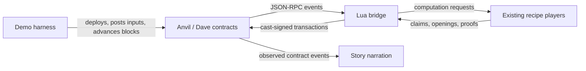

# Lua PRT bridge

The Docker recipe runs the two calculator epochs against Dave contracts on
Anvil, using the existing players from [prt.lua](prt.lua) and
[prt-dishonest.lua](prt-dishonest.lua). The image compiles the pinned Dave
contracts during its build (see Image build and patches). Each invocation starts
a fresh chain, deploys an application, streams the two calculator epochs,
settles their results, and records a story from the contract events. Epoch zero
stays empty, as in the normal Dave deployment.

## Running the recipe

Run these from the emulator repository.

```sh
make -C doc build-prt-image
make -C doc run-prt-bridge PRT_MODE=smoke
make -C doc run-prt-bridge
```

If the matching emulator image has already been built, `EMULATOR_IMAGE_READY=yes`
on `build-prt-image` reuses it. The target still builds the uarch binary and the
docs and PRT runtime images.

The runtime image `cartesi/machine-emulator-prt:devel` includes the emulator,
calculator snapshot, contracts, Foundry, and Lua scripts. Each invocation starts
a fresh Anvil, which uses public development accounts and listens only inside
the container. Smoke mode uses one honest player. The default story uses eight
actors for each calculator epoch and one honest player for the empty epoch zero.
Its actors post false claims, forge input, corrupt execution, and disconnect.
The story exercises child propagation, timeout cleanup, staging, acceptance, and
independent bond recovery.

Each run creates a fresh directory under `doc/recipes/cache/prt-chain/` (or
under the absolute host path supplied through `PRT_OUTPUT_DIR`). Top-level
`story.txt` combines the three epoch stories and `deployment.json` records
deployed addresses. `signed-transactions.json` retains the shared signer
journals across epochs. Each `epoch-N/` retains its input files, `epoch.json`,
checkpoint, `story.txt`, `chain-logs.json`, `transactions.jsonl`, and local
claim artifacts. Calculator epochs also retain `proof-vectors.json` with
native/Solidity comparisons. The run also retains `continuation-checkpoint/`,
produced by loading the epoch-2 checkpoint in a fresh player and sealing an
empty continuation. This is an off-chain persistence check, not another settled
epoch on Anvil.

For development, `make -C doc test-prt-bridge` mounts current recipe sources
into the existing runtime image. `run-prt-bridge` tests the packaged sources.
`make -C doc test-prt-bridge-unit` runs only the bridge fixtures.
`make -C doc test-prt-transactions` runs the controlled Anvil transaction tests;
`make -C doc run-prt-bridge PRT_MODE=transactions` runs their packaged version.

Both run targets accept `PRT_INPUT_CONFIRMATIONS` (default `8`) and
`PRT_DISPUTE_CONFIRMATIONS` (default `4`). Either also accepts `safe` or
`finalized`; depth zero explicitly uses the tip. These demo defaults are not
a quantified reorg-risk guarantee. Anvil's consensus tags do not reproduce
Ethereum's consensus process; numeric depths exercise delayed observation here.

`PRT_TEST_REORG=yes` injects a dispute reorg in epoch one. The harness snapshots
after its input context is established, waits until a child tournament is
observed (a root join in smoke mode), then restores the snapshot and mines a
replacement block. It retains the same players and bridge. The run must still
accept both calculator epochs and recover the root bonds. `epoch-1/reorg.json`
records the replaced tip and observation height.

## Validator design

The goal is to simplify the implementation of validator nodes. Dave's
Permissionless Refereed Tournaments (PRT) resolve competing claims about machine
execution by narrowing a disagreement until a state-transition proof can settle
it. The contracts define and enforce the dispute rules. Their events should
provide enough information for a validator to participate with minimal context,
without reconstructing the dispute's entire state or reproducing the contracts'
internal logic.

An additional goal is for events to translate into what amounts to a remote
procedure call into the validator node. The request means "as soon as the chain
reaches this eligible block, call this contract with this context and the
additional information produced by off-chain machine execution." The fixed
translation supplies the target and method, the event supplies the relevant
context and timing, and the validator computes the missing claim data or proof.
The validator derives these calls afresh on each tick. Any expiry limits how
long a call remains eligible.

An event can also cancel or replace a call that an earlier event scheduled.
Expressing participation through these scheduling and cancellation operations
lets the node respond directly to the contract's events with the information
it computes off chain.

The contracts retain authority over pairing, clock accounting, result selection,
and whether a submitted move is valid. Their events expose the identities,
coordinates, and deadlines needed for the next action. For example, a match
advance identifies the claims, the tree node to open, and the response window.
The validator can compute that opening directly, without replaying earlier
moves to reconstruct the match. This keeps dispute complexity where it is
unavoidable and avoids implementing another copy in each validator.

Each tick fetches the relevant epoch's logs through a selected observation head and
applies the table to an initially empty action set. Later events replace or
cancel earlier actions. The node persists its own claims and computation
context, and its one tracked transaction. Event logs, discovered identities,
and the action set are temporary. Restarting or changing branches needs no
separate dispute-observation recovery procedure. The next tick reads the chain
again.

These goals apply whether the validator is a single program or several
components. The event interface does not require a bridge/player separation.

Our implementation calls the existing Lua player's computation methods directly
from the bridge. Together they form one validator node.

```text
Dave events and block heads <-> Lua bridge tick
                                     |
                                     +-> prt.new_player(...) computation methods
                                     +-> signed transactions
```

The player owns the computation. Given the initial machine state and inputs,
it executes the machine, builds computation hash trees, and answers requests for
claims, tree nodes, and proofs. In the documentation, a simulated referee asks
for these values. Our bridge calls the same computation handlers without a
bridge/player socket. The simulator's scheduling callbacks and response
barriers are not part of this interface.

The bridge derives due actions, computes a selected response, refreshes its
chain observation, and simulates the still-eligible call before submitting at
most one transaction per tick. It also handles chain access, signing, and
transaction tracking. Neither component maintains a parallel model of the
tournament's internals. Consistent log fetching, computation-context validation,
and transaction reconciliation remain necessary across reorgs and restarts.

The simplification is confined to observation. Discovery still follows child
event streams, and log fetching, signing, input retrieval, machine execution,
and proof encoding remain validator work.

## Responsibilities



The contracts own pairing, clocks, move validity, and tournament results. The
players own machine execution, computation hash trees, and proof generation.
The bridge translates contract events into player requests and transactions.
The harness owns deployment, actor selection, local mining, and narration.

| File | Responsibility |
| --- | --- |
| [Dockerfile.prt](../Dockerfile.prt) | Fetch, patch, and compile contracts; package the emulator and recipe |
| [prt-demo.sh](prt-demo.sh) | Prepare the run directory and keystores; start and stop Anvil |
| [prt-demo.lua](prt-demo.lua) | Deploy the application, deliver inputs, construct actors, drive the run, and narrate events |
| [prt-epoch.lua](prt-epoch.lua) | Deliver the ordered input stream, validate the seal, and start the dispute |
| [prt-bridge.lua](prt-bridge.lua) | Observe the dispute, derive eligible actions, call players, and submit responses |
| [prt-transactions.lua](prt-transactions.lua) | Journal signed candidates, reconcile exclusive account nonces, and replace pending transactions within fee limits |
| [prt-ethereum.lua](prt-ethereum.lua) | Decode ABI events, encode calls, translate coordinates, and serialize proofs |
| [prt-cast.lua](prt-cast.lua) | Make HTTP JSON-RPC requests and invoke cast for signing and submission |
| [prt.lua](prt.lua) | Execute inputs, build commitments and proofs, and save or load epoch checkpoints |
| [prt-dishonest.lua](prt-dishonest.lua) | Apply the existing dishonest strategies to the same player implementation |
| [prt-bridge-test.lua](prt-bridge-test.lua) | Check ABI encoding, process boundaries, event ordering, and scheduling |
| [prt-transactions-test.lua](prt-transactions-test.lua) | Exercise gas surges, dropped transactions, cancellation, journal reload, and nonce reorgs on Anvil |
| [prt-proof-test.lua](prt-proof-test.lua) | Compare native and deployed Solidity transition verification |

All actors currently run in one Lua process. Each has its own player object,
claim state, and signing account. These are the recipe players, with checkpoint
export at sealing and authenticated continuation from the previous last-output
proof. Their computation handlers are called directly, without a socket protocol
or the simulated referee's scheduling callbacks.

Each calculator epoch has eight actors: the honest player, a forger that
substitutes an input, a tamperer that corrupts execution, two fabulists that
alter claimed hashes, and three quitters that post claims and disconnect.
A separate keeper account handles cleanup and acceptance. The deployer and
input sender use account zero, players use accounts one through eight, and
the keeper uses account nine. The transaction journal has exclusive ownership
of player and keeper nonces across epochs. Only the honest
player exports a checkpoint, selected explicitly by the harness. The epoch
listener passes each actor's configured checkpoint destination to its player.

Keep authoritative events, reusable computation, address associations, and
persisted transaction candidates distinct. An operation should maintain its
own invariants, and a query should not conceal execution or persistence.

## Image build and patches

The Dockerfile fetches the Dave revision pinned by the `DAVE_REF` build argument
in `doc/Dockerfile.prt`, initializes its `machine/step` submodule, and installs
the locked Solidity dependencies. The pinned revision comes from
[Dave pull request 297](https://github.com/cartesi/dave/pull/297),
which adds the events the bridge consumes. These include creation descriptors
and bonds, ordered match participants, computation coordinates and states, and
the deadlines needed to respond or clean up. `StandingChanged` exposes the
current candidate and its result and expiry boundaries.

Both patches live beside this file, in `doc/recipes/`.

- [prt-contracts.patch](prt-contracts.patch) applies to the Dave checkout. It
  only replaces Dave's two-level table with the recipe geometry and keeps
  Dave's events, gas allocations, and commitment budget. Deployment uses the
  existing `DaveAppFactory`.
- [prt-step.patch](prt-step.patch) applies inside `machine/step`. It changes the
  generated `UARCH_PRISTINE_STATE_HASH` to match this emulator build. It changes
  no instruction semantics or verification rules.

The build checks patch applicability with `git apply --check`, applies the
patches, records them in the container's Git checkouts, and compiles through
Dave's `just build-smart-contracts`. The final image contains the resulting
creation bytecode and ABI artifacts under `/opt/dave`, together with Foundry,
the emulator, Lua scripts, and the calculator machine snapshot. A run deploys
these packaged artifacts. It does not fetch or compile contracts at startup.

The recipe root has height 62 and stride 2^30, and its leaf tournaments have
height 30 and stride 1. This matches the players' `prt.new_geometry(10)`
(2^10-mcycle periods). The recipe keeps 2^10-mcycle periods because Dave's
canonical table (root height 54 at stride 2^38, so 2^18-mcycle periods) makes
each leaf claim about 256 times more expensive to compute. The bridge checks
creation descriptors against the player's geometry when building claims.

The pristine-uarch patch is necessary because a matching `CM_MARCHID` alone does
not guarantee a matching pristine uarch state. Startup compares the deployed
verifier's pristine hash with the emulator's hash before playing.

## Deployment and InputBox

`prt-demo.sh` creates keystores from Anvil's public development mnemonic and
starts Anvil with funded accounts, the Prague hardfork, and RPC listening on
`127.0.0.1:8545` inside the container. The shell stops Anvil when the run exits.

`prt-demo.lua` reads each compiled artifact, appends ABI-encoded constructor
arguments to its creation bytecode, and submits a deployment through
`cast send --create`. It deploys:

1. The `Tournament` implementation and `CartesiStateTransition` verifier.
2. `CanonicalTournamentParametersProvider` and `MultiLevelTournamentFactory`.
3. The real Rollups `InputBox` and `ApplicationFactory`.
4. Dave's existing `DaveAppFactory`, then calls `newDaveApp`.

`newDaveApp` creates the Application and DaveConsensus, migrates the Application's
validator to that consensus, and renounces ownership in one transaction. The
harness learns both addresses from `DaveAppCreated`. There is no custom
application deployment helper. The calculator configures no withdrawals,
refund portals, or sentries; its staging period is ten blocks.

DaveConsensus immediately seals empty epoch zero. The honest bootstrap player
joins that tournament, proves its unchanged final machine and empty outputs
root, and stages the result. The keeper accepts it after the staging period.
Acceptance seals epoch one from the InputBox bounds at that moment. Every later
acceptance follows the same contract lifecycle.

## Streaming the two calculator epochs

| Dave epoch | Global input indices | Calculator payloads | New global output indices |
| --- | --- | --- | --- |
| 0 | none | empty bootstrap | none |
| 1 | 0-2 | `6*2^1024 + 3*2^512`, `invalid input`, `2^2048` | 0-1 |
| 2 | 3-5 | `(2^256 - 1) * (2^256 - 1)`, `scale=80; sqrt(2)`, `scale=100; 355/113` | 2-4 |

Each payload ends with a newline. The invalid input is rejected by the
calculator and adds no output. These are the two input groups from the README
calculator example, numbered one and two on Dave to preserve its empty epoch zero.

Before submitting a group's inputs, the harness constructs its players from
the preceding epoch's final machine and last-output proof. It submits each
payload through `InputBox.addInput(application, payload)` using the deployer
account, then waits for the input observation policy before delivering it. Inputs for epoch one arrive
while epoch zero awaits settlement; inputs for epoch two arrive while epoch one
awaits settlement. Thus input execution is complete before the corresponding
seal arrives; sealing finalizes commitments and output proofs.

The harness follows this order:

| Step | Computation and persistence | Chain progress |
| --- | --- | --- |
| Deploy | Seal the empty bootstrap player and save checkpoint 0 | DaveAppFactory creates the app and consensus; epoch 0 is sealed |
| Accumulate epoch 1 | Load checkpoint 0 and process inputs 0-2 as they become confirmed | Inputs enter InputBox while epoch 0 is unsettled |
| Settle epoch 0 | On the new seal, finalize epoch 1 and save checkpoint 1 | Stage and accept epoch 0; consensus seals epoch 1 |
| Accumulate epoch 2 | Load checkpoint 1 and process inputs 3-5 as they become confirmed | Inputs enter InputBox while epoch 1 is unsettled |
| Settle epoch 1 | On the new seal, finalize epoch 2 and save checkpoint 2 | Resolve epoch 1's disputes, stage, and accept; consensus seals epoch 2 |
| Settle epoch 2 | Check its accepted result against checkpoint 2 | Resolve epoch 2's disputes, stage, and accept; consensus seals empty epoch 3 |

The next player's execution starts from the preceding player's computed final
state before that state is accepted on-chain. The later seal must authenticate
that starting state. Accumulation and disputes overlap in the epoch lifecycle;
the demo drives their handlers synchronously in one Lua process.

`prt-epoch.lua` fetches InputBox and consensus logs through one block selected
by the input policy and
sorts them together by block and log index. For this application's `InputAdded`,
it requires consecutive global indices, writes the exact `input` bytes to a
file, and calls every player's `input_added(index - input_begin, filename)`.
The bytes include InputBox metadata. Proof encoding always uses these original
bytes, even when a dishonest player privately substitutes a forged input.

On `EpochSealed`, the listener checks the initial machine hash, preceding outputs
root, and both input bounds against its bootstrap and processed inputs. It calls
`epoch_sealed(input_count, checkpoint_directory)` on the honest player and seals
the other players without saving them. It then constructs the dispute bridge.
Logs after the seal cannot feed more inputs to that player. Repeated observations
check their already-applied prefix and never execute an input twice. A changed
input history aborts. Once sealed, the listener checks the saved seal's block
hash instead of extending its input history with later dispute events. A reorg
crossing this stronger stability boundary requires rebuilding the epoch;
ordinary dispute reorgs do not roll back the player.

## Machine and output continuation

The player owns checkpoint persistence. At sealing it stores its exact final
machine before closing execution. Each honest `epoch-N/checkpoint/` contains:

- The emulator's stored machine.
- `last-output-proof.json` when output history is nonempty.
- `epoch.json`, written last, with format version, initial and final machine
  hashes, outputs root and count, input count, and period geometry.

The last-output proof authenticates the global last leaf and lets the next
player reconstruct the output frontier. It is distinct from the machine proof
that binds the outputs root to the final machine for on-chain staging. If an
epoch produces no new outputs, it preserves the inherited last-output proof.
The empty bootstrap has no last-output proof.

`prt.load_epoch(directory)` reads and validates the manifest and output proof,
returning the arguments for `prt.new_player(dapp, label, last_output_proof)`.
Player construction loads and checks the machine hash, verifies that the proof
is the last output, and binds its root to the machine's CMIO tx buffer. A missing
proof is valid only when that buffer contains the empty output-tree root.

The bootstrap API for a saved checkpoint is:

```lua
local prt = require("prt")
local dapp, last_output_proof = prt.load_epoch(checkpoint_directory)
local player <close> = prt.new_player(dapp, "honest", last_output_proof)
```

The returned `dapp` contains the stored machine directory, its expected initial
hash, and the geometry. The bridge supplies this new epoch's global input lower
bound separately and converts incoming indices to player-local offsets.

A checkpoint initially records the player's computation. Later settlement must
agree with its final machine and outputs root. The demo checks that agreement
for every epoch. It also opens the epoch-two checkpoint in a fresh player and
seals an empty continuation, checking that the final machine and inherited proof
remain unchanged. Checkpoints bootstrap later epoch execution; they do not
restore a partially completed dispute. Signed transactions have a separate
journal described below.

Load [prt.lua](prt.lua) as a module and construct the player with
new_player(dapp_contract, label, last_output_proof), using the contract context with
its validated geometry and initial state hash. The player loads the initial
machine and owns its cache and initially empty filename table. Keep the player in a
<close> local; its __close method releases the cache and any unfinished execution.
Construction checks the initial machine and initializes the open epoch computation.
As InputAdded events arrive, verify and materialize each input in a local file and
call input_added(epoch_local_index, filename) in order. The player retains the
filename and reads the file whenever delivery or proof generation needs its bytes.
Files must remain readable and unchanged throughout the player's lifetime, including
disputes. The player owns a working machine pair, accumulated claim forest, and
outputs between calls. Its cache retains thinned historical input boundaries
for later proof replay. Each input handler advances the owned pair, handles
rollback for rejected input, and offers the next boundary to the cache through
consider(next_input_index, machine). Sealing closes the working pair after
capturing the final-machine proofs and optional persistent checkpoint.
Builders retain computation state only. Their methods receive the working machine
explicitly when needed; no machine is attached to a builder.
At sealing, check the initial state and exact input bounds, then call
epoch_sealed(input_count, checkpoint_directory) to finalize the computation and
output proofs and optionally store the final machine and last-output proof. Call commit_mcycle_claim
only after epoch_sealed; do not defer input processing until EpochSealed.
The player retains every accepted output and its proof, and answers client requests through
player:prove_output(output_index). The demonstration offers the last output to the
referee. Final-machine output-root proofs are captured at sealing. A later
player loads the saved bootstrap inputs with prt.load_epoch(directory); its
constructor checks the machine hash and authenticates the output frontier.

There is no separate begin event. Each player and cache describe one epoch.
At each seal whose locally computed final state can start another epoch, the
bridge can spawn a player for that next epoch and concurrently drive the
sealed epoch's dispute. The first player is bootstrapped from the deployment's
initial state. EpochSealed's initial hash describes the sealed epoch, not the
next one.

Call the remaining event_handler entries for commit_uarch_claim,
reveal_bisection, seal_divergence, prove_state_transition,
and prove_outputs_merkle_root, passing the player as the first argument.
Coordinates passed to these handlers are zero-based. Read claim children through
player.trees[claim]:get_child_hashes(position, height). The prove_output handler
and output selection are not needed for staging.

## Event observation and scheduling

The bridge polls HTTP JSON-RPC. Input and dispute observation policies each
accept a nonnegative successor-block depth or the `safe`/`finalized` RPC tag.
A depth of four selects block 100 when the tip is 104. Missing consensus tags
fail rather than silently reading latest. Standalone listeners default to
`finalized` for inputs and four blocks for disputes. The Anvil recipe uses eight
and four blocks so the confirmation behavior is exercised explicitly.

Each dispute tick samples the live tip and selects its observation block,
retaining their heights separately. It requests `eth_getLogs` from block zero
through the selected observation block for the
factory, consensus, and root tournament. Each `NewInnerTournament` event adds
the child address to the set of streams fetched during the same observation.

Event signatures and layouts come from the compiled contract ABIs. The bridge
uses `cartesi.evmu` to decode indexed fields and event data, preserving full
256-bit coordinates. Its selectorless `encode_abi` and `decode_abi` operations
also encode constructor arguments and decode view results. The bridge sorts
logs by block and log index, rejects duplicate
positions. Removed logs, inconsistent block hashes, and a changed observation
hash discard the observation for retry. It also checks that the observed epoch seal binds the configured
root tournament to the expected initial machine hash.

Every tick reconstructs temporary tournament contexts, latest match events,
standings, and eligible actions from those logs. Later events replace or cancel
earlier actions. Player computations and local claims survive ticks; the
observed dispute state is reconstructed afresh. Computation caches are scoped
to the epoch's player and keyed by initial hash, base cycle, geometry, and kind.
A child recreated at the same address is bound to its replacement descriptor;
its contested states are checked again. Earlier computations remain reusable,
but an address association is dropped when the new match does not involve that
actor's parent claim.

The bridge's `refresh()` operation observes the chain and updates claim
associations. If it computes a new claim, it observes again before scheduling,
since computation can outlive the joining window. `jobs()` only derives actions
from that view and the available claims; it does not run players or write files.
Both binding and unbinding a claim update the diagnostic claim file.

| Observed information | Action derived by the bridge |
| --- | --- |
| Tournament creation, descriptor, and bond | Ask the player for a commitment and join |
| `MatchCreated` or `MatchAdvanced` | Request a bisection opening or divergence seal |
| `NewInnerTournament` | Build the relevant uarch commitment and join the child |
| `LeafMatchSealed` | Request and encode a state-transition proof |
| Emitted timeout boundaries | Claim a timeout win or eliminate the match |
| `StandingChanged` | Propagate a child result, stage the root result, or recover a bond |
| `MatchDeleted` | Cancel pending actions for that match |
| `EpochStaged` | Schedule acceptance after the configured staging period |
| Next `EpochSealed` | Confirm acceptance and check the stored final machine and outputs root |

The bridge uses the emitted response, timeout, result, and expiry boundaries.
Eligible windows include their start and exclude their end. Inclusion is tested
at the actual tip plus one, never at the delayed observation height plus one.
Confirmation lag consumes part of the available response window. It performs the
necessary interface translation, including selecting the responder from
bisection parity, but does not reproduce the contracts' clock discounts or
child-return refill accounting. A separate keeper account handles permissionless
cleanup without owning a player or computation claim.

### What the bridge keeps

- Durable claim data and computation context, so the bridge can recognize its
  claims and restore the trees needed to answer. The restoration requirements
  below distinguish these from optional machine checkpoints.
- The one tracked transaction, if any, with its signed bytes, hash, nonce,
  fee fields, owning job identity, and computation context, and the highest
  nonce ever published. The record is cleared once its nonce is consumed at
  the current execution head. Completion events still use the observation policy.
  The high-water mark is persisted before each publication
  and never lowered, since consumption on an unfinalized branch can be undone.
- For this tick, the calls that events authorize. Each entry holds the contract
  address, method, arguments supplied by events, first eligible block, any expiry block,
  and the information still needed from the player. It also identifies the
  event that scheduled it. Descriptor fields and bond values are part of these
  arguments.
- For this tick, links supplied by events between a child tournament and its
  parent match, and between a root tournament and its epoch. These identify the
  parent contract that receives a child's result and the epoch a root result settles.
- For this tick, the contract addresses to fetch, which are the configured
  consensus and factory, the epoch's root tournament, and children discovered
  through events.

The bridge does not keep a copy of the tournament's matches, clock balances, or
standings. Each tick processes freshly fetched events in event order, adding,
replacing, or canceling calls and establishing tournament links. It retains no
event cache or
block ancestry between ticks, and adopts no pending player requests.

Each candidate call is a job in the temporary action set. Some calls act on
one match between two claims.
They answer a request to reveal tree nodes or prove a transition, claim a
timeout win, or eliminate the match. We call these match jobs. A MatchAdvanced
event replaces the pending calls for that match, and a MatchDeleted event
cancels them.

Other calls act on a tournament's outcome. They propagate a child tournament's
winner to its parent tournament, eliminate a finished child tournament, stage
a root tournament's result, or recover a bond.
We call these result jobs. A StandingChanged event replaces the pending calls
based on that tournament's outcome. They remain separate calls, so completing
one does not discard the others. For example, propagating a child tournament's
winner must leave its bond-recovery call pending.

This distinction identifies which calls an event replaces or cancels. Match
jobs use the key (tournament, matchIdHash, kind), with kind respond,
timeoutWin, or eliminate. Result jobs are grouped by tournament, with separate
propagate, eliminate, stage, and recover entries. A call to join a tournament
has its own entry.

Creation events populate the action set's tournament groups with the descriptor and
bond value needed by their jobs. Replacements carry forward the context they
need. These values belong to the current observation, not a persistent tournament record.

Each job retains its key, authorizing event identity (chain ID, block hash,
transaction hash, event index given by RPC logIndex), call, fixed arguments,
required computation, an eligibility block, and an optional expiry block, the
first block at which the call is no longer eligible.
Jobs for propagating or eliminating a child tournament also identify the parent
match, so deleting that match cancels those calls while leaving the child
tournament's bond recovery pending. No contract-issued revision numbers are
needed. Event identity records provenance. Cached computation never authorizes
a transaction without a currently eligible job with matching context and arguments.

### Event to job conversion

Event fields follow the tournament ABI of the pinned Dave revision.
H is the emitted descriptor height. own(x) means the player holds commitment
x in the relevant context. claimer(x) means our own join established x, which
the submitter on CommitmentJoined shows. The joining deadline is
descriptor.startInstant + descriptor.allowance.
New claims are accepted only before that block. An expiry at block d means d
is the first expired block, so the transaction must be included before d.

Each claim is identified by its computation hash. To read its root children,
look up `tree = assert(player.trees[computation_hash], "event concerns a claim this player does not hold")`
and call `tree:get_child_hashes(0, tree.height)`. The two returned hashes combine
to produce that computation hash. The timeout, leaf-win, and propagation rows
below use this lookup for the named claim; they require no simulator scheduling
handler. Parent propagation reads the parent claim's root children, using that
tree's height rather than the child tournament's height.

| Event | Action-set changes | Player computation | Window |
|---|---|---|---|
| TournamentCreated(R, descriptor, bondValue) | Populate R's context with the emitted descriptor and bond, pending association with EpochSealed | None | Immediate |
| InputAdded(app, index, input) | Verify and materialize the input for this application | input_added(index - lo, filename) on the open epoch player | As inputs arrive, before sealing |
| EpochSealed(e, lo, hi, initialHash, R) | Record the root tournament and epoch association, watch R, install join with the descriptor and bond from TournamentCreated | Check initialHash and the processed input bounds, epoch_sealed(hi - lo), then commit_mcycle_claim | Before R's joining deadline |
| MatchCreated(h, one, two, leftOfTwo, responderDeadline, eliminableAt) | Holder of one responds. Holder of two may win by timeout. Everyone installs elimination | Respond with reveal_bisection(one, 0, H, leftOfTwo), or seal_divergence(one, 0, leftOfTwo) for H = 1. Timeout uses the root children of two. Elimination needs no computation | Respond before responderDeadline. Timeout in [responderDeadline, eliminableAt). Eliminate from eliminableAt |
| MatchAdvanced(h, one, two, otherParent, leftNode, pos, currentHeight, responderDeadline, eliminableAt) | Replace all three match jobs. Responder r is one when H - currentHeight is even, otherwise two. Holder of r responds. Holder of the other side may win by timeout. Everyone installs elimination | reveal_bisection(r, pos, currentHeight, leftNode), or seal_divergence(r, pos, leftNode) at height 1. Timeout uses the root children of the other claim | Same as MatchCreated |
| LeafMatchSealed(h, one, two, agreeState, pos, f1, f2, d1, d2, eliminableAt) | Replace match jobs. Either holder proves. Holder of the longer clock may win by timeout. Everyone installs elimination | prove_state_transition at split(baseCycle + (pos << log2Stride)), plus the held claim's root children for winLeafMatch. Timeout uses the root children of the longer-clock claim | Prove before min(d1, d2). Timeout in [min, max), absent when equal. Eliminate from max |
| NewInnerTournament(h, C, one, two, f1, f2, descriptor, bondValue) | Cancel parent's three match jobs. Record C -> (emitter, h), populate C's context with the emitted descriptor and bond, watch C. Install initial parent.eliminateInnerTournament(C). Holders of one or two join C with its bond | commit_uarch_claim(input_index, period_index from C.baseCycle, {f1, f2}) | Join before C's joining deadline. Initial elimination from C's joining deadline |
| MatchDeleted(h, one, two, reason, winner) | Cancel match jobs and linked child tournament's propagation/elimination. Preserve its bond recovery | None | Immediate |
| StandingChanged(n, d, pc, resultAt, expiresAt), child tournament C of P | Replace C's result group. With n > 0 install no result work. With n = 0 and d nonzero, holder of pc propagates, everyone eliminates at expiry, claimer(d) recovers. With n = 0 and d zero, everyone eliminates at resultAt | Propagation uses the root children of pc for P.winInnerTournament(C, children). Elimination and recovery need no computation | Propagate in [resultAt, expiresAt). Eliminate from expiresAt, or resultAt with no candidate. Recover from resultAt |
| StandingChanged(n, d, 0, resultAt, 0), root tournament R of epoch e | Replace R's result group. With n = 0, own(d) installs the stage job only if the winner's final state satisfies MachineValidityProof; claimer(d) independently installs the recover job. Report a terminal winner without scheduling staging. Otherwise install no transaction jobs | prove_outputs_merkle_root for staging and the final-state validity check | From resultAt |
| CommitmentJoined | Complete our matching join job, including when another submitter joined the same commitment | None | Immediate |
| EpochStaged | Complete the named epoch's stage job, regardless of sender. Preserve recovery | None | Immediate |
| BondRecovered | Complete that tournament's recovery job, regardless of sender | None | Immediate |

Creating a child tournament schedules its elimination at its joining deadline in case nobody
joins. Later StandingChanged events cancel or replace that scheduled call as
specified in the table.

For a finished child tournament, first try winInnerTournament on its parent
tournament to submit the winner, then tryRecoveringBond on the child tournament
to request the winning claimant's bond payment. For a finished root tournament
whose winning state satisfies MachineValidityProof, first try
stageTournamentResult to submit the winning result and output proof, then
tryRecoveringBond to request the winning claimant's bond payment.

A correct commitment can win while proving that the application reached a
terminal state that MachineValidityProof rejects. Check the player's final-state
proof against the committed final state and the pinned validity rules. Report
that terminal outcome, suppress staging, and continue bond recovery. Winning
does not make an invalid final state stageable. This check uses the player's
computation and needs no additional event field or tournament view.

This order is a scheduling preference, not a contract requirement. The calls
are independent. The tryRecoveringBond call remains eligible if someone else
submits the result or our attempt to submit it fails.
Use the link from the child tournament to its parent match to cancel calls to
the parent tournament after a MatchDeleted event for that match. Preserve bond
recovery on the child tournament.

### Coordinates

Before constructing a bisection request, require 1 <= currentHeight <= H,
0 <= pos < 2^H, and alignment to 2^currentHeight. Leaf divergence positions
instead identify individual transitions. Do not apply the bisection alignment
rule to them. Validate event topic counts, data lengths, and tournament origin.

Dave meta-cycles are 92-bit integers. Decode them with evmu's big-integer type
and pass only fitting split coordinates to the player.

```text
input_index             = cycle >> 68
mcycle_in_input         = (cycle >> 20) & (2^48 - 1)
period_index            = mcycle_in_input >> log2_period
state_transition_offset =
    ((mcycle_in_input & (2^log2_period - 1)) << 20) |
    (cycle & (2^20 - 1))
```

Requests for computation hash tree nodes pass segmentStartPosition and
currentHeight unchanged.
The state-transition request remains prove_state_transition(input_index,
period_index, state_transition_offset). Its machine access logs and input bytes
are encoded for the pinned proofs argument of winLeafMatch.

### Computation and refresh

Compute for an eligible job, then refresh the head and derive the action set
again before using the result. Blocks continue advancing while a method runs,
and there is no simulator barrier or fresh allowance for computation. Cache
deterministic results by deployment, epoch computation context, claim identity,
and exact method arguments. Obsolete results can remain reusable computation
data but cannot authorize a transaction. A reorg changing inputs or the initial
state requires a different computation context.

### Ticks, log discovery, and restarts

Input delivery and dispute observation have separate policies. A policy is a
nonnegative number of successor blocks, or the RPC tag safe or finalized.
Depth k selects max(0, tip - k); it does not count the selected block itself.
There is no automatic fallback from an unavailable consensus tag to latest.
Use a stronger policy for inputs and epoch boundaries, and a shorter delay for
disputes. The recipe defaults to depths eight and four respectively; these are
demo settings, not a quantified mainnet risk guarantee. The epoch listener's
standalone default is finalized; the dispute bridge's default is four blocks.

The observation number and hash authorize jobs. The current execution head
supplies the clock and account nonce: a transaction will be included after that
head, not after the delayed observation block. Confirmation delay, computation,
RPC latency, and inclusion delay must together fit the emitted response windows.
A lag policy does not remove the need to recover from deeper dispute reorgs.
If a reorg crosses the accepted input history or epoch seal, stop and rebuild
from a matching checkpoint; ordinary dispute reorgs leave the player intact.

A tick performs the following steps. Its observation starts empty every time.

1. Sample the current tip and select the observation block using the dispute
   policy, retaining its number and hash separately from the tip. Fetch the
   relevant consensus and factory logs from the epoch's discovery range, including its creation
   transaction, through that fixed head number. Fetch the root tournament's
   logs from creation. Use address/topic filters and bounded chunks, bisecting
   rejected ranges, and do not restrict cleanup discovery to our own claims.
2. Associate TournamentCreated with EpochSealed before authorizing a root join,
   checking the matching addresses and initial hashes. Discover children from
   authenticated parent events and fetch each child's logs from creation through
   the selected head, including activity in its creation block. Repeat until
   every reachable stream has been fetched. Include finished children whose
   parent matches were deleted, since their bonds may still be recoverable.
3. Deduplicate by full event identity and apply all events in block,
   transaction-index, logIndex order to the temporary action set. Verify that
   the selected head is still canonical and the fetched ranges belong to that
   branch before accepting the observation. Discard inconsistent reads and
   retry on a later tick. Range requests must not independently use "latest".
4. Read the signing account's nonce at the current execution head and reconcile the
   tracked transaction. A tracked nonce below the account nonce was consumed
   and its record is cleared. A tracked nonce equal to it is still pending. A
   tracked nonce above it means a reorg orphaned mined transactions, and the
   account nonce is the next one to use. Every nonce from the account nonce
   through the high-water mark may still carry an untracked candidate, since
   nodes keep orphaned and future-nonce transactions queued, and they become
   executable again as the nonces below them are consumed. This step only
   selects the nonce and the proposed action. When the account nonce is at or
   below the high-water mark and no tracked transaction is pending at it, the
   proposed action is the due job, or a cancel when none is due. Filter jobs
   by their windows at the expected inclusion block after the current tip.
   Retain canonical receipts awaiting observation to avoid publishing a completed
   action again while its event is still behind the confirmation boundary.
   An orphaned receipt cannot suppress a job. Choose due work
   deterministically, prioritizing expiring joins, responses, timeout wins,
   and child propagation by earliest expiry ahead of work without expiry.
   Prefer staging before recovery for the same root tournament. Use stable
   job-key ordering for remaining ties, and ensure unrelated cleanup and
   recovery make progress when urgent work permits.
5. Compute the selected job's missing data. Refresh the observation from a new
   selected observation head, applying the same policy and steps 1-4 again,
   before preparing a transaction.
   Reuse the result only for a currently eligible job with the same computation
   context and arguments. If that job disappeared or expired, end this tick.
   Cached computation may be useful on a later one. Also defer the transaction
   if more urgent work appeared during computation.
6. Simulate the exact eligible call against current execution state, since
   timeout and expiry checks must see the actual clock. Recheck the observation
   block's canonical hash and the current inclusion window, and persist and
   publish at most one transaction at the nonce selected in step 4. Publication happens only here. Replacements,
   rebroadcasts, and nonce cancellations count toward that limit, and each is
   an attempt to out-bid whatever candidate holds the nonce. A pending
   transaction can be handled without starting new machine work.

No calls execute while processing historical events, so skipped heads never
execute already-expired historical jobs. A new MatchCreated preceding an old
MatchDeleted inside one winning transaction needs no special handling, since
the two matches have different keys.
CommitmentJoined, EpochStaged, and BondRecovered from every participant complete
the corresponding jobs before selection. After building a new claim, the
refreshed observation also recognizes events for that newly known commitment.

Each tick re-fetches the full relevant event history. There is no retained
finalized event prefix, ancestry traversal, rollback routine, or pending
computation adoption. Caching the finalized prefix of that history is a
possible later optimization that changes fetch cost, not the derived actions.
A replacement clone at the same address receives the descriptor and bond value
from its replacement creation event. Relaunching the process restores claim
records, the tracked transaction, and the high-water mark, then runs the same
tick. An interrupted computation can restart from durable claim data.

This removes special recovery machinery for dispute observation, not the need
for consistent chain reads or transaction reconciliation. Retain pending bond
recoveries in the epoch's discovery scope after staging, since staging alone
does not finish the validator's work. Dispute events follow the configured
observation delay; they need not come from the latest head. Contract validation
remains authoritative if the chain changes after preparation, and simulation does not guarantee inclusion
before a deadline. Measure full-history fetch and computation latency against
the deployment's windows as part of acceptance.

## Proofs and transactions

The bridge calls the existing handlers for commitments, bisection openings,
divergence seals, transition proofs, and outputs-root proofs. `prt-ethereum.lua`
converts their results into ABI arguments and the Solidity witness format.
Transition witnesses combine input delivery when applicable, a uarch step,
and a reset at the appropriate boundary. Eight-byte accesses serialize their
complete authenticated 32-byte machine-tree leaf.

For a due action, the bridge prepares or reuses its response, rebuilds the
observation under the same policy, and requires the job and claim still to be
eligible. It rechecks the live inclusion window and the observation block hash.
An attempt owns preparation, revalidation, proof checking, and submission;
the scheduler owns job selection and retry timing. If a waiting attempt returns
a different head, the scheduler starts over before reusing pending-job choices
or cancellation decisions from the earlier view.
`prt-transactions.lua` preflights against the current canonical execution state,
excluding its own pending transaction. It estimates gas with a 20% allowance,
bounded by the block gas limit. A call that first becomes valid in the next
block can be retried once that block arrives. `prt-cast.lua` invokes `cast mktx`
with explicit chain ID, nonce, gas, value, and both EIP-1559 fee fields, using
the actor's keystore and password file. It decodes the signed bytes with cast
and verifies the signer and every requested field before publication. Arguments
are shell-quoted; stdout and stderr are separated, and failures do not print
signer paths or endpoint configuration.

The bridge publishes at most one transaction per tick and never waits for
mining. Before each publication, the tracker writes all signed candidates,
their hashes, nonce, fee fields, job context, and observation to
`signed-transactions.json` using a temporary file and rename. It then publishes
the raw bytes with `eth_sendRawTransaction`. The journal is shared across epoch
coordinators and contains no signer credentials. Setup deployments and input
posting still use synchronous `cast send` on the separate deployer account.

The initial fee cap targets twice the current base fee plus the suggested tip,
within configured limits. The tip has a 1 gwei floor. If a transaction is still
pending after `PRT_FEE_BUMP_BLOCKS` blocks (default 3), the tracker replaces it
at the same nonce. Both fee fields increase by at least
`PRT_FEE_BUMP_PERCENT` (default 15, rounded up); current network estimates can
raise them further. `PRT_MAX_FEE_PER_GAS` defaults to 100000000000 wei (100 gwei),
and `PRT_MAX_PRIORITY_FEE_PER_GAS` to 10000000000 wei (10 gwei). These are demo
defaults, not a guarantee of timely inclusion. Hitting a ceiling reports the
blocked account while observation continues. The tracker retains the nonce and
can resume if fees fall. All four settings can be passed as Make variables.
If an affordable candidate is missing from the node at the fee ceiling, the
tracker can republish its identical signed bytes after revalidation, using the
same retry interval. This also recovers a crash before the original broadcast.

Every tick revalidates pending work against the dispute observation and actual
inclusion deadline. Useful pending work keeps its nonce; another action for
that signer cannot silently queue behind it. Obsolete work is immediately
replaced by an eligible action, or by a zero-value self-transfer cancellation.
A replacement that cannot be prepared or simulated falls back to cancellation.
Cancellation obeys the same fee ceilings and cannot revoke a transaction
already distributed to block producers. An older candidate can still win.
Signed candidates survive underpriced or ambiguous publication responses;
later attempts raise fees at the retained nonce.

Nonce reconciliation reads current chain state, independently of delayed event
observation. The journal retains a high-water nonce and every candidate even
after mining. If a reorg retreats the account nonce, every recorded nonce up to
that high-water mark must be consumed or replaced again. Future queued
candidates may race that reconciliation. The bridge does not defend a stale
claim merely because one of its own older transactions joined it.

A mined receipt suppresses duplicate publication while its event is awaiting
confirmation. The bridge checks the receipt's block hash; an orphaned receipt
releases that suppression. Completion still comes from observed events.
Anvil EVM rejections suppress an attempt only for the same live tip. A new tip
or replacement branch can make it eligible again. Other provider or transport
errors during observation, simulation, or signing abort the run; a publication
RPC rejection instead retains the signed attempt for retry. Dishonest moves can therefore
be rejected during preflight without broadcasting a reverting transaction.
Attempts and results are recorded in `transactions.jsonl`.

Transition proofs also run through the native verifier, using the emitted
agreed state and authoritative InputBox bytes. The bridge requires native
validity to agree with an `eth_call` pinned to the observed block hash. Proven
invalid witnesses are retained as invalid for that exact event and actor. A
later execution-state rejection can instead mean another actor already answered,
so it is not treated as a native/Solidity disagreement. Before the tournament, the proof
checks exercise input delivery, an ordinary step, an instruction reset, a late
period reset, and absent input. Each class also checks rejection of corrupted,
truncated, and trailing witnesses. This comparison exposed the pristine-uarch
mismatch; no verification check was removed to make resets pass.

### State-transition proof encoding

CartesiStateTransition interprets the coordinate as the output leaf of one
transition, with agreeState as its predecessor. Encode the existing player's
logs in the order the verifier consumes them.

| Position | Witness segments, in order |
|---|---|
| Input-window opening, cycle modulo 2^68 = 0 | Eight-byte big-endian input length, the exact input bytes, the CMIO access log when an input exists, then the uarch-step access log |
| Closing transition of a uarch span, cycle modulo 2^20 = 2^20 - 1 | Uarch-step access log, then uarch-reset access log |
| Every other position | Uarch-step access log |

At an absent input, encode a zero length and omit the CMIO log; the uarch step
still executes. An existing empty input also has length zero but requires its
CMIO log. The provider's input presence distinguishes them. Delivery to a
terminal machine still requires the CMIO no-op proof when an input exists.

For each access, encode its raw read value for an eight-byte word access; for
a larger read, encode its 32-byte raw value followed by its read hash; for a
larger write, encode its read hash. Append the access's sibling hashes in their
existing order. Concatenate accesses and logs without ABI padding inside this
witness, then encode the complete witness as winLeafMatch's bytes argument.
The verifier requires exact access-log consumption and rejects trailing or
truncated data, as well as input bytes supplied for an absent input.

Fixtures must check the sealed agreeState and the claimed post-state, including
the canonical root substituted by a rejecting reset. Ordinary steps, delivery,
reset, and padding must agree across the player and Solidity before live use.

### Bonds and transactions

Attach the creation event's bondValue as msg.value to every join. Budget for the
root tournament's bond, the active child tournament's bond, transaction gas, and further joins before
earlier recovery payments arrive. PartialBondRefund needs no action.
Recovery pays the recorded winning claimer, which is our signer only when our
join established that claim. Holding the same commitment does not establish
ownership of someone else's bond. Preserve recovery independently of parent
settlement, and complete it from BondRecovered. A payment failure can return
false without reverting, so a successful receipt alone does not prove recovery.

Track one transaction and keep one pending nonce per signer. Reorgs can leave
additional candidates of ours in the network. For each eligible job, simulate
the exact call, signer, and bond value against current execution state. Check
that the selected observation block remains canonical, that the job remains
current under its observation policy, and that its window allows inclusion
beyond the actual tip before signing. A
simulation revert ends that attempt. A later tick derives the job again if the
events and window still permit it. Simulation is cheap, so another due job
may be tried in the same tick, with the same refresh and simulation checks,
provided no transaction has been published. A wasted computation instead ends
the tick, as the tick steps say. Try each job at most once per tick so one
reverting call cannot block every other action or cause a tight retry loop.

Sign, atomically persist the signed bytes, hash, nonce, fee fields, and owning
job identity and computation context, then publish. A crash before recording
must not leave an unrecorded broadcast transaction. After relaunch, the bridge
can query or republish the recorded transaction without allocating another
nonce for the same attempt.

If pending past the configured fee-bump interval, replace at the same nonce
with a higher fee. Revalidate the tracked job every tick, not only then. As
soon as it is obsolete, replace it at the same nonce with a currently eligible
simulated job, or with a cancel when no job is due. A replacement, a cancel
included, is an attempt to out-bid the candidate at that nonce, not a
guarantee that it will not be included. A publication that the network rejects
as an underpriced replacement is retried at that nonce with an escalated fee
on a later tick. Persist each replacement before publication. It takes over
the record. Nonce reconciliation settles which candidate was mined, and the
events settle what it achieved.

A consumed nonce, reverted or not, completes nothing by itself. Fresh
canonical events complete or replace work. Bond recovery requires
BondRecovered, and anyone's EpochStaged completes staging. A consumed nonce
frees the next one without waiting for finality.

Contracts enforce the current validity of every call, so most stale calls
revert and cost gas. Not all do. A broadcast transaction can execute after the
observation that justified it has changed, and a well-formed stale call is
accepted. A stale root join is the case that matters. joinTournament checks the
bond, the commitment's final leaf, and the joining deadline, not that the
commitment was computed over the epoch's current inputs, so a join broadcast
before a reorg changed those inputs can post a claim over inputs the chain no
longer has and expose its bond. A cancel is attempted the tick the tracked
job becomes obsolete. Untracked candidates cannot be retracted, only out-bid
at their nonces as the tick describes, and a replacement accepted by one node
does not stop another block producer from including the original. When a
stale join does execute, the next tick's fresh observation shows a
CommitmentJoined from our own submitter for a commitment that is not a current
claim. The bridge does not defend that claim, and derives no response or
timeout-win work for it, but it still performs the permissionless cleanup of
the claim's matches like any other. If the joining window is still open, it
joins with the correct claim, which needs another bond. Budget for it. If the
window has closed, it reports that the correct claim can no longer enter this
epoch. Pin one exclusive signing account, so no other sender consumes its
nonces.

Only prt-cast.lua invokes cast. The implemented transport uses HTTP JSON-RPC
for headers, events, calls, nonces, receipts, and raw transaction publication;
cast mktx signs and cast decode-transaction checks the resulting fields. Pin output
formats, capture stdout and stderr separately, and check exit status. Read the
endpoint from ETH_RPC_URL. Use a keystore or external signer. Never put raw
private keys on command lines. Redact endpoint, credentials, account, and signer
paths from diagnostics. Signed transaction records must not contain credentials
or endpoint configuration.

## Mining and narration

Anvil mines submitted transactions immediately. When no action is eligible,
the harness mines empty blocks so the next transaction can reach the next
emitted deadline or a receipt's observation boundary. It also mines the blocks
needed to confirm each input and epoch seal. Mining policy belongs to the
harness; the bridge never mines.

The harness narrates observed contract events into `story.txt`: joins,
pairings, child creation, isolated transitions, proof and timeout wins,
staging, acceptance, and bond recovery. Player labels are associated with their
submitted commitments; the contract events supply the outcomes and reasons.
Success requires the winning commitment to equal the honest player's claim,
the accepted machine and outputs root to match its checkpoint, and the root
bond to have been recovered. Staging alone does not complete an epoch.

## Validation

A passing story run produces these epochs.

| Epoch | Input range, end excluded | Cumulative outputs | Invalid transition proofs rejected |
| --- | --- | --- | --- |
| 0 | [0, 0) | 0 | 0 |
| 1 | [0, 3) | 2 | 4 |
| 2 | [3, 6) | 5 | 4 |

All six calculator inputs wait for the input confirmation depth and are
processed before their on-chain seal. Rejected proofs fail the Solidity
preflight check and are never broadcast. The native/Solidity proof suite must
pass in both calculator epochs. Settlement must match the checkpoint chain, and the final empty
continuation must retain the identical last-output proof, final machine hash,
output count, and outputs root. With `PRT_TEST_REORG=yes`, the same players
keep their computations across the replaced branch, and both calculator epochs
still accept the honest result and recover their root bonds.

The fixtures and suites also cover the following.

- Five native/Solidity proof classes per calculator epoch, with corrupted,
  truncated, and extended proofs rejected.
- The bridge's independent Foundry ABI comparison, shell quoting and exit
  status checks, deadline boundaries, ordered input delivery, replay protection,
  mismatched seals, and changed input history.
- Confirmation depths and consensus tags without fallback, delayed replacement
  inputs, actual-tip deadline checks, receipt suppression and orphaning, retry
  after branch changes, and child replacement at the same address, including
  replacement matches in which the actor no longer participates.
- Anvil gas surges with mining disabled, same-nonce fee replacement, fee ceilings
  and subsequent recovery, dropped candidates, underpriced replacement errors,
  write-before-publication, cancellation and older-candidate races, reverted
  receipts, multi-nonce reorgs, process-crash journal reload, and identical-byte
  rebroadcast at the fee ceiling. Bridge fixtures also check that failed
  replacements do not strand obsolete work and useful pending jobs do not
  oscillate between competing actions from the same account.
- Read-only job derivation, expiry during claim computation, refreshing
  cancellation decisions after a head change, and consistent rejection of nonce
  advances beyond the journal's owned range.
- The existing PRT protocol suite, including the added checks for invalid,
  missing, or non-last continuation proofs and preservation through an empty
  epoch.

These targets rerun the protocol suite or test edited bridge sources against
the existing image.

```sh
make -C doc test-prt-protocol
make -C doc test-prt-bridge
make -C doc test-prt-transactions
```

## Current limits

The recipe streams and accepts the two fixed calculator groups. Accepting epoch
two also seals the normal empty epoch three; the demo stops there and shuts down
Anvil. It does not expose a persistent chain for interactive use or run an
unbounded epoch service. The configured zero-sentry settlement path waits the
full staging period; sentry-driven early acceptance is outside this demo.

The geometry, deployment, and actor population are fixed for this recipe.
Reading complete log histories is suitable for the disposable local chain;
log pagination and a general deployment-discovery interface are not implemented.
Saved claim files are diagnostic artifacts, not a complete dispute restart
protocol. The transaction tracker can reload its journal and reconcile pending
or orphaned candidates, but callers must restore the corresponding player and
observation context before submitting work. The demo does not yet implement
that complete relaunch flow. Its journal assumes one writer and process-crash
atomic rename; it does not provide an fsync-based power-loss guarantee. It keeps
all signed candidates for the bounded run, without journal compaction.
Reorgs crossing accepted input history or its seal
still fail closed. A confirmation depth is a policy, not absolute finality.

The packaged story validates the Lua players against the pinned contracts. It
does not qualify the Rust node against this emulator's uarch pin; release-pinned
Rust proof fixtures require their own coordinated update.

## TODO

### Factory table validation

The bridge currently checks each creation descriptor against the player's
geometry. It should also validate the factory's complete tournament table
when pinning the deployment, before asking the player to compute a root claim
or submitting a join. Read tournamentLevelCount() once and require two levels.
Then read tournamentParameters(0) and tournamentParameters(1) once, for the root
and leaf tournaments respectively. The table calls the stride exponent log2step,
which corresponds to log2Stride in creation events.

- Both parameter rows must report levels equal to two.
- The root tournament's height plus log2step must equal 92.
- The leaf tournament's log2step must be zero.
- The leaf tournament's height must equal the root tournament's log2step.
- Both heights must be below 63, so the player's leaf counts fit in signed
  64-bit integers.

Derive the player's mcycle period exponent from the validated root tournament
log2step minus ROLLUP_LOG2_MAX_UARCH_CYCLES_PER_MCYCLE. For example, root stride
exponent 30 and root and leaf heights 62 and 30 use prt.new_geometry(10).
Require each creation event's height, log2Stride, level, and kind to agree with
that table, with a non-leaf root tournament at level zero and a leaf tournament
at level one. Waiting until the first NewInnerTournament to check the leaf
geometry would be too late, because the player could already have joined a root
tournament it cannot defend. These factory reads validate the deployment once.
Descriptors and bond values for individual tournaments still come entirely from
events.

### Claim restoration and successive opponents

The player's trees in `prt.lua` contain frontier forests of bundle roots and
bundle-collection callbacks. `tree:get_node_hash` and `tree:get_proof` open a
bundle implicitly when the forest query reaches an opaque hash;
`tree:get_child_hashes` uses two node-hash queries. The local `open_bundle` helper
invokes the tree's collector, backed by `collect_mcycle_bundle` or
`collect_uarch_cycle_bundle`, to reconstruct the bundle by machine replay.
`hash_tree.frontier_forest_expand_leaf` checks the reconstructed subtree against
the committed leaf hash before installing it. The query then retries, and later
queries within that bundle reuse the installed subtree without machine replay.
Saving a computation hash, commit response, or Lua object handle alone does not
restore this ability.

Persist a versioned claim record containing the forest, tree and bundle
heights, expected computation root, root children, and final-state proof.
Bind it to the deployment, epoch initial hash, exact verified input payloads
and bounds, geometry, and, for a child claim, input and period coordinates.
Store immutable inputs and the initial machine snapshot locally, or references
to durable content-addressed copies. On restart, recreate the player and its
bundle-collection callbacks from this context, wrap the restored forest with
`prt.new_tree(height, bundle_height, forest, collect_bundle)`, and verify the
root and saved proofs before storing it in `player.trees[computation_hash]`.
Never deserialize callbacks or assume that saving their Lua handles preserves
machine resources.

Machine checkpoints and expanded bundles are optional accelerators. With only
the initial snapshot and stored forest, replay must reconstruct the same
claim. Validate both that equality and the time needed to answer after a cold
restart. Checkpoint persistence is required for a deployment whose response
windows cold replay cannot meet.

The player stores mcycle and uarch trees in `player.trees`, indexed by computation
hash. The `commit_mcycle_claim` and `commit_uarch_claim` event handlers add their
trees to that table; committing a different uarch claim retains earlier claims.
Keep durable claim records bound to their computation context as described above.
Each new opponent can open a child tournament over a different period, requiring
the corresponding child commitment and contested final-state check. Check the emitted geometry, coordinates, and contested final
states even when reusing a previously computed claim for the same period.
Restore the tree for the selected job's context before
calling a handler. Never resolve a claim solely by tournament address or by
the most recently committed uarch claim.

Retain claims for earlier children until the root settlement is finalized, so
a reorg can make their dispute work current again. Recovery remains discoverable
from those children's event streams until it succeeds and is finalized. It
needs the tournament and winning-claim/claimer identities, not the old child's
full tree. Parent propagation uses the parent claim's children. Pending recovery
must not prevent the player from committing or answering for the next child claim.

### Remaining tests

- Exercise every event-table row with both orientations and responder parities,
  sealing at height one, equal tree children, invalid coordinates, and unrelated
  cleanup.
- Advance blocks during claim builds, bundle opening, proof generation, and
  pending inclusion, so computation consumes allowance. Include skipped heads
  and jobs without expiry. Reject stale computation before publication, and
  verify that inclusion at the first expired block fails even when the proof is
  correct. Propagate a won child only inside [resultAt, winnerExpiresAt), ahead
  of old bond recovery. Cover the child-return refill and the response-budget
  discount on leaf and timeout wins. The next emitted deadlines must suffice
  without the bridge calculating either adjustment.
- Cover an empty child tournament with no further events, a join replacing its
  initial elimination, later pairing canceling prospective results, and both
  sides of the last match eliminated while a third claim wins. Parent deletion
  must cancel propagation and elimination of the child tournament while
  preserving recovery. EpochStaged and BondRecovered from other participants
  must complete their respective jobs.
- Discover child tournament creation and activity within one transaction, one
  block, and one polling range. Arbitrary range partitioning must produce the
  same action set.
- Carry one claim through successive opponents A and B with children over
  different periods. Keep B's jobs when A's MatchDeleted arrives after the new
  MatchCreated, answer with B's child commitment while A's child recovery is
  pending, restore A's child claim if a reorg makes it active again, and
  recover its bond independently.
- Assert that discovering root and child tournaments makes no descriptor or
  bond-value view calls.
- Start each tick with empty observation state. At the same head, ordinary and
  restarted ticks must derive identical actions. Change branches during range
  fetching and reject mixed observations. Include disappeared completion events
  and deadline filtering at the replacement head.
- Broadcast a root join, then replace the branch so the epoch's inputs change
  while the root descriptor stays the same, and let the original join win the
  replacement race. The next tick must recognize the unintended join from
  CommitmentJoined, derive no response or timeout-win work for it, and still
  schedule elimination of its matches. With the joining window open it must
  join with the correct claim and a second bond. With the window closed it
  must report that the correct claim can no longer enter. Test both.
- Change branches, not only heads, while a direct player method runs. The
  refreshed action set must reject stale results. Matching context and
  arguments may reuse deterministic computation.
- Stop and relaunch during claim construction, after claim persistence, and
  before a previously unopened bundle is needed. Restore forests and callbacks
  with only the initial machine snapshot, check the same roots and proofs,
  and measure cold-replay latency. Reject corrupt records, incompatible record
  versions, or reuse after inputs, initial state, geometry, or child coordinates
  change. A cached commit response alone must not count as a restored tree.
- Cover a bond payment that fails without reverting, and recovery continuing
  when another participant stages first.
- Extend the proof classes to terminal no-ops, rejecting resets, transitions
  after rejection, consecutive rejected inputs, and an existing empty input
  distinguished from an absent one.
- Win a root tournament with an honest terminal-state commitment. Report the
  terminal outcome, submit no staging transaction, and recover the winning
  claimer's bond. Confirm that Solidity rejects its machine validity proof.
  Tournament victory must not bypass the validity check.
- Measure full-history fetching and response computation with many reachable
  children and pending recoveries. Check deadline priority, eventual unrelated
  cleanup and recovery, and the deployment's response windows with one pending
  nonce.
- After fixtures and Anvil pass, run an opt-in read-only smoke test, then a
  funded low-stakes testnet trial.
